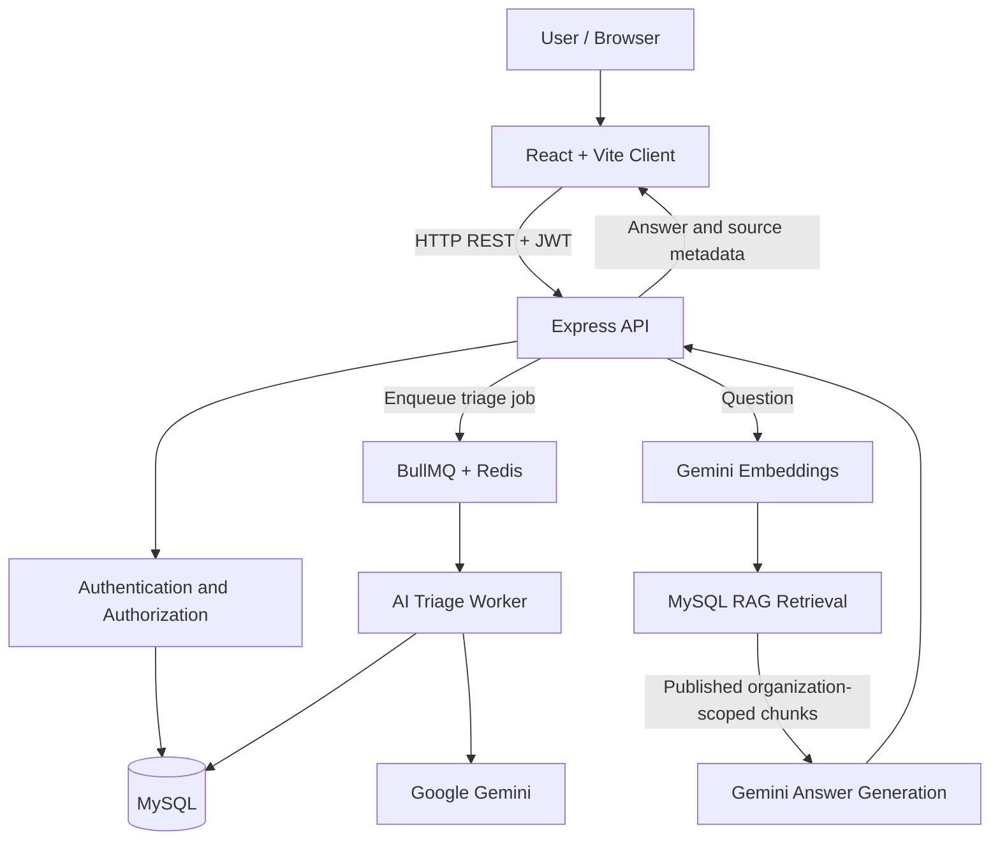

<div align="center">

# SupportDesk AI Pro

### AI-Powered, Multi-Tenant Customer Support Platform

A full-stack helpdesk application with secure ticket management, asynchronous AI ticket triage, and knowledge-base question answering powered by Retrieval-Augmented Generation (RAG).

**Built with React · Node.js · Express · MySQL · Redis · BullMQ · Google Gemini**

[Features](#-features) · [Screenshots](#-application-walkthrough) · [Architecture](#-architecture) · [Setup](#-run-locally) · [Testing](#-testing)

</div>

---

## 📌 Project Overview

SupportDesk AI Pro is a multi-tenant customer support system designed to help support teams manage tickets and answer customer questions using organization-specific knowledge.

It combines a React frontend and Express REST API with MySQL persistence, Redis-backed background jobs, and Google Gemini for AI-powered ticket classification and RAG-based answers.

### The problem it addresses

Support teams need to organize incoming requests, identify urgent issues, keep customer conversations private, and find accurate answers from support documentation. This project brings those workflows into one application and adds AI assistance while retaining authorization and organization boundaries.

## ✨ Features

### 🔐 Authentication and authorization
- JWT-based authentication and password hashing.
- Role-based access for supported user roles.
- Protected API routes.
- Organization-aware access checks.

### 🎫 Ticket management
- Create, list, and view support tickets.
- Track ticket status, category, priority, assignee, and SLA deadline.
- Maintain ticket conversations.
- Support public replies and staff-only internal notes.
- Validate status transitions and staff assignments.
- Restrict customer access to their own tickets.

### 🤖 Asynchronous AI ticket triage
- Classify ticket content with Google Gemini.
- Generate category, priority, sentiment, and confidence information.
- Validate structured model output before saving it.
- Queue work using BullMQ and Redis instead of waiting for AI processing during ticket creation.
- Retry failed jobs and recover eligible pending jobs.
- Persist triage suggestions and status in MySQL.

### 📚 Knowledge-base management
- Create and update knowledge-base articles.
- Keep new articles in draft status until published.
- Chunk published content and generate embeddings.
- Store article chunks and embeddings in MySQL.
- Rebuild indexed chunks when published content changes.

### 🔎 Retrieval-Augmented Generation (RAG)
- Embed user questions using a Gemini embedding model.
- Retrieve semantically relevant chunks from published knowledge-base articles.
- Scope retrieval to the authenticated user's organization.
- Generate answers using retrieved source content.
- Return source metadata with answers.
- Return a safe fallback when no relevant knowledge-base chunks are retrieved.
- Instruct the LLM to acknowledge missing information instead of inventing policies or facts.

### 🛡️ Security and reliability
- Organization-scoped ticket and knowledge-base operations.
- Customer restrictions for ticket ownership and internal notes.
- Request validation with Zod.
- Security middleware and configured CORS.
- Automated backend tests.

> AI-generated classifications and answers can be incorrect. Review important decisions and evaluate RAG answers against the source articles before using the system for real customer support.

## 🖥️ Application Walkthrough

The screenshots below are intended to show the **actual running application**. Add your own screenshots to `docs/screenshots/` using the filenames listed here. Until those files are added, GitHub will display broken image placeholders for the corresponding entries.

### 1. Login

The user opens the application and signs in with a valid account.


### 2. Dashboard

After authentication, the user lands on the dashboard and can navigate to the application's available sections.


### 3. Ticket list

The ticket list provides access to the support requests available to the signed-in user.


### 4. Create a ticket

A customer submits a ticket with a subject and description. The API saves the ticket and attempts to enqueue AI triage.


### 5. Ticket details and conversation

The ticket detail screen shows ticket information, status, and the conversation. Customer-facing replies must remain separate from staff-only internal notes.


### 6. AI triage result

After the background worker processes the queued job, the ticket should reflect its saved category, priority, and triage status.


### 7. Knowledge-base articles

Staff create or update an article as a draft and publish it when its content is ready for retrieval.


### 8. RAG question and answer

A user asks a question. The application retrieves relevant published article chunks from the user's organization and returns an answer with source metadata.


### 9. Test results

The recorded development verification includes 72 passing backend tests across 7 test suites and a successful Vite production build.


#### How to add the screenshots

1. Run the application locally using the instructions below.
2. Open each relevant page in the browser and capture the real UI.
3. Use Windows Snipping Tool (`Win + Shift + S`) or another screenshot utility.
4. Save clear PNG images using the exact filenames above in `docs/screenshots/`.
5. Do not include API keys, passwords, private customer information, tokens, or sensitive environment values in screenshots.
6. Review the images in VS Code, then commit the images together with `README.md`.

Create the folder if it does not exist:

```powershell
New-Item -ItemType Directory -Force .\docs\screenshots
```

Only include screenshots for screens that are actually implemented. If a section is not available in the current UI, omit that image and update the walkthrough rather than creating a mock screenshot.

## 🏗️ Architecture



### Main workflows

**Ticket triage**
1. A customer creates a ticket.
2. The API saves it to MySQL and queues a triage job when the queue is available.
3. The worker validates the job and ticket organization.
4. Gemini generates structured triage data.
5. The worker validates and persists the result.

**RAG question answering**
1. An authenticated user submits a question.
2. The API derives the organization ID from the authenticated user.
3. The query is embedded and compared with stored article-chunk embeddings.
4. Retrieval considers published articles belonging to that organization.
5. Gemini generates an answer from the retrieved sources.
6. The API returns the answer and source metadata.

## 🧰 Technology Stack

| Area | Technology |
|---|---|
| Frontend | React, JavaScript, Vite |
| Client routing | React Router |
| HTTP client | Axios |
| Backend | Node.js, Express.js |
| Validation | Zod |
| Authentication | JWT and bcrypt-based password hashing |
| Database | MySQL |
| Database driver | mysql2 |
| LLM | Google Gemini via `@google/genai` |
| Embeddings | Gemini embedding model |
| Background jobs | BullMQ |
| Queue backend | Redis |
| Security middleware | Helmet, CORS |
| Testing | Jest, Supertest |
| Version control | Git and GitHub |

**Vector storage:** Embeddings are stored in MySQL JSON columns. The current implementation does not require a separate vector database.

## 📂 Project Structure

```text
supportdesk-ai-pro/
├── .github/
│   └── workflows/          # CI configuration
├── client/
│   ├── src/
│   │   ├── pages/          # React pages
│   │   └── services/       # API client and service modules
│   ├── package.json
│   └── vite.config.js
├── database/
│   ├── schema.sql           # Base database schema
│   └── ...                  # Additional migrations, if present
├── server/
│   ├── src/
│   │   ├── ai/              # Triage, embeddings, retrieval, answers
│   │   ├── config/          # Database and application configuration
│   │   ├── middleware/      # Authentication and authorization
│   │   ├── routes/          # REST API routes
│   │   ├── tests/           # Automated tests
│   │   └── workers/         # Background workers and recovery
│   ├── scripts/             # Maintenance scripts
│   └── package.json
├── docs/
│   └── screenshots/         # README screenshots (add locally)
└── README.md
```

This is a high-level map of the main areas; check the repository for the complete current file list.

## ⚙️ Prerequisites

Install the following before running the project:

- Node.js and npm.
- MySQL Server.
- Redis.
- A Google Gemini API key with access to the configured models.
- Git.

Use the versions supported by the dependencies in the checked-out repository.

## 🚀 Run Locally

### 1. Clone the repository

```powershell
git clone https://github.com/sreyeshmandly/supportdesk-ai.git
Set-Location .\supportdesk-ai
```

If your local folder is named `supportdesk-ai-pro`, you can continue using that folder instead.

### 2. Install dependencies

Open separate VS Code terminals, or run:

```powershell
Set-Location .\server
npm install

Set-Location ..\client
npm install
```

### 3. Configure MySQL

Create the application database and a separate test database. Use the database names expected by your local configuration.

Example only:

```sql
CREATE DATABASE supportdesk
  CHARACTER SET utf8mb4
  COLLATE utf8mb4_unicode_ci;

CREATE DATABASE supportdesk_test
  CHARACTER SET utf8mb4
  COLLATE utf8mb4_unicode_ci;
```

Apply `database/schema.sql` to the appropriate database. If additional migration files exist, apply them in their documented order. Do not run tests against a production database.

### 4. Configure backend environment variables

Create `server/.env` and configure the variables required by the current configuration files. Do not copy real secrets into the README or commit them to Git.

The AI implementation references:

| Variable | Purpose |
|---|---|
| `JWT_SECRET` | Signs and verifies authentication tokens |
| `GEMINI_API_KEY` | Authenticates Google Gemini API requests |
| `GEMINI_MODEL` | Configures the generation model |
| `GEMINI_EMBEDDING_MODEL` | Optional embedding-model override; the embedding module has a default |
| `PORT` | Optional HTTP port; the server defaults to `4000` |
| `CLIENT_ORIGIN` | Optional frontend origin for CORS |
| `REDIS_HOST` | Redis hostname used by the worker |
| `REDIS_PORT` | Redis port used by the worker |
| `REDIS_PASSWORD` | Redis authentication setting used by the worker |

Also configure the MySQL connection variables expected by `server/src/config/db.js`. Confirm the exact variable names in that file before running the application.

### 5. Start the backend API

In a terminal:

```powershell
Set-Location .\server
npm run dev
```

The API defaults to port `4000` unless configured otherwise. Keep this terminal running.

### 6. Start Redis and the triage worker

Ensure Redis is running and reachable with the configured connection details. Open another terminal:

```powershell
Set-Location .\server
npm run worker
```

The worker is required for asynchronous ticket triage. Ticket creation may still succeed if queueing fails, but the job will not be processed until the queue and worker are healthy.

### 7. Start the frontend

Open another terminal:

```powershell
Set-Location .\client
npm run dev
```

Open the local URL printed by Vite, usually `http://localhost:5173`.

### 8. Verify the workflow

1. Sign in with a valid account.
2. Open the dashboard and navigate through the available sections.
3. Create a support ticket.
4. Check that the ticket appears in the ticket list.
5. Confirm that triage is queued and processed by the worker.
6. Open the ticket and test the conversation workflow.
7. As an authorized staff user, create and publish a knowledge-base article.
8. Ask a question answered by that article.
9. Ask a question not covered by the article and check that the response acknowledges the missing information.
10. Test that users from another organization cannot access the ticket or knowledge-base content.

The application requires a configured MySQL database, Redis, valid Gemini access, and suitable test data for these workflows.

## 🔌 API Overview

The Express application registers these main route groups:

| Route | Purpose |
|---|---|
| `GET /health` | Health endpoint |
| `/api/auth` | Authentication |
| `/api/users` | User management |
| `/api/tickets` | Ticket and conversation operations |
| `/api/knowledge-base` | Knowledge-base operations and RAG |

### RAG endpoint

```http
POST /api/knowledge-base/ask
Content-Type: application/json
Authorization: Bearer <token>
```

Request:

```json
{
  "question": "What information is required to request a refund?"
}
```

The endpoint uses the authenticated user's organization. It returns an answer and source metadata when available. Refer to the route implementation for the exact response schema and authorization behavior.

## 🗄️ Database

MySQL stores application records and RAG embeddings. The schema includes the main entities for organizations, users, tickets, ticket messages, knowledge-base articles, article chunks, and AI suggestions.

- Base schema: `database/schema.sql`
- Additional migrations: inspect the `database/` directory and apply them in order.

Back up important databases before making schema changes.

## 🧪 Testing

### Backend automated tests

From the `server` directory:

```powershell
npm test -- --runInBand
```

### Frontend production build

From the `client` directory:

```powershell
npm run build
```

### Latest recorded verification

On October 23, 2026, the development environment reported:

- **7 backend test suites passed**
- **72 backend tests passed**
- **Vite production build passed**
- **1,665 frontend modules transformed**

These results describe that recorded run. Re-run the checks after making code changes.

## 🔒 Security Notes

- Keep `.env` files and credentials out of version control.
- Use a strong, unique `JWT_SECRET` in every deployed environment.
- Use least-privilege MySQL credentials.
- Restrict CORS to the expected frontend origin.
- Use HTTPS in production.
- Keep test data separate from real customer data.
- Verify tenant isolation and role permissions before deployment.
- Treat AI outputs as suggestions and review important decisions.
- Avoid including tokens, secrets, or real customer data in screenshots and logs.

## 🚢 Deployment Checklist

Deployment is environment-specific; no live deployment is claimed by this README.

Before deployment, verify:

- [ ] A production frontend API URL is configured.
- [ ] Backend CORS allows only the deployed frontend origin.
- [ ] Production MySQL schema and migrations are applied.
- [ ] Redis is available to the worker.
- [ ] Gemini API access and model names are valid.
- [ ] Secrets are configured through the hosting provider's environment settings.
- [ ] Frontend build succeeds.
- [ ] Backend tests pass.
- [ ] Authentication, tenant isolation, ticket workflow, and RAG are tested end-to-end.
- [ ] Database backups and basic monitoring are configured.

## 🗺️ Possible Future Improvements

These are optional ideas, not claims that they are currently implemented:

- More comprehensive end-to-end tests.
- Monitoring and operational dashboards for background jobs.
- Ticket analytics and reporting.
- Email notifications.
- Audit logs for sensitive staff actions.
- Expanded RAG retrieval and grounded-answer evaluation.
- Production deployment automation.

## 👨‍💻 Author

**Sreyesh Mandly**

- GitHub: [@sreyeshmandly](https://github.com/sreyeshmandly)
- Project repository: [sreyeshmandly/supportdesk-ai](https://github.com/sreyeshmandly/supportdesk-ai)

## 📄 License

No license has been specified here. Add a `LICENSE` file and update this section if you intend to grant others permission to reuse or distribute the project.

---

<div align="center">

**SupportDesk AI Pro**  
*Secure ticket management, asynchronous AI triage, and knowledge-grounded support.*

</div>
